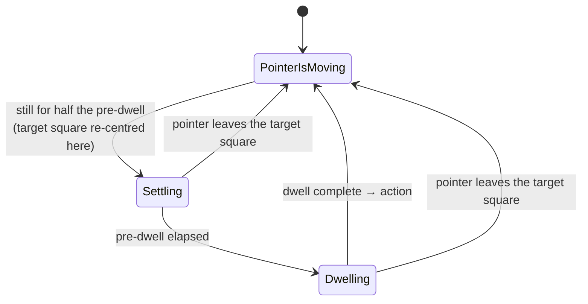

# Reticle design

Behaviour specification for Reticle. Code lives in `src/Reticle`; the dwell engine is in `Engine/` and has no
WPF dependency beyond `System.Windows.Point`/`Rect`, so `tests/Reticle.Tests` drives it with a fake clock.

## Dwell engine

`App` reads the physical cursor position (`GetPhysicalCursorPos`) once per rendered frame, at most every 16 ms, and
passes it to `DwellEngine.Update`. The engine owns one `ButtonDweller` per toolbar button and one `ScreenDweller`.

Each dweller runs this state machine:

| Quantity | Value |
|---|---|
| Dwell time | setting, default 2000 ms, 300–5000, step 100 |
| Pre-dwell | dwell time / 10 |
| Dwell progress | (elapsed − pre-dwell) / dwell time; the action fires at pre-dwell + dwell time |
| Target square | side = target size in DIPs (default 60, 30–100, step 5) × the DPI scale of the monitor under the pointer, centred where the pointer settled |

- Nothing happens until the pointer has moved at least once after a dweller was created.
- After an action the dweller stays idle until the pointer leaves the target square, so a resting pointer never
  repeats a click.
- The screen dweller is inactive while the click type is Rest or the pointer is over a toolbar button.
- Click sound: `SystemSounds.Beep` when enabled (default on).
- Sizes are DIPs (effective pixels) so the target and toolbar look the same on monitors with different scaling. The
  engine works in physical pixels and converts with `IDisplayScale` (`MonitorDisplayScale`: `MonitorFromPoint` +
  `GetDpiForMonitor`), which tests replace with a fixed scale.

### No snapping

Clicks land exactly where the pointer is when the dwell completes; the cursor is never moved. The progress ring is
always centred on the live pointer position, so drifting inside the target square moves the ring and the click
point with it.

## Click types

`None` (Rest), `LeftClick`, `RightClick`, `DoubleLeftClick`, `Drag`.

- Rest and Left click always stay selected. Right, Double and Drag apply to one action, then revert to Left click,
  unless the user selects the same type twice in a row, which locks it (padlock badge).
- Drag: the first dwell presses the primary button, the second releases it. While a drag is held a grey track ring
  follows the pointer. Changing click type mid-drag releases the button.
- All clicks use logical buttons: with swapped mouse buttons, Left click still sends the user's primary button.
- Opening Settings from the toolbar resets the click type to Left click.
- Toolbar button actions are deferred to the dispatcher, so a modal window opened by a button never freezes the
  frame tick.

Clicks are injected with `SendInput`.

## Dwell ring

A topmost, click-through, non-activating tool window (`DwellOverlayWindow`) of target size, moved with
`SetWindowPos`. Its WPF size is the target size in DIPs, which WPF scales to the monitor's DPI; `SetWindowPos` uses the
target size × the DPI scale of the monitor under the pointer, so both agree on the window size and the ring stays
centred on the pointer on every monitor. The arc thickness scales with the window, and a dark outline drawn under
the arc keeps it readable over any background without blur effects.

## Toolbar

Six dwell buttons: Rest, Left click, Right click, Double click, Drag, Settings. Button size is its own setting
(default 50 DIPs, 40–120, step 5), independent of the target size. The toolbar docks to one of eight positions on the
primary screen's work area (default top centre); left and right positions stack it vertically. It never takes focus
and is not shown on the taskbar.

Each button shows its dwell progress as an accent fill rising from the bottom, clipped with a rounded
`RectangleGeometry` recomputed on every size change.

## Notification area

Reticle has no taskbar button. The notification-area icon opens Settings on left click; its right-click menu has
*Settings* and *Close application*. Close application exits immediately. The *Exit Reticle* button in Settings asks
for confirmation first.

## Settings

Target size (with preview), toolbar size, dwell time, click sound, toolbar position (full-screen picker with eight
arrows; the toolbar hides while it is open so it cannot take dwells meant for the arrows), theme, language, and
start-up options. Start-up options are hidden on the sign-in desktop.

Every change applies and saves immediately, so the window has a single close control: *Done* in the footer (also
Escape and Enter); there is no title-bar close button. Controls are at least 36 DIPs, larger than the smallest target
square (30 DIPs), so a dwell stays on the control it started on. The header icon is a vector `DrawingImage`
(`AppIconImage` in `Theme.xaml`) because WPF decodes only the first, 16 px frame of the `.ico`.

Persisted to `%ProgramData%\Reticle\settings.xml`. The folder grants Everyone full control so the sign-in screen
instance (running as SYSTEM) shares the same settings. Elements: `TargetSize`, `SoundEnabled`, `PositionX`,
`PositionY`, `DwellTime`, `ButtonSize`, `Theme`, `Language`. Missing, out-of-range or unknown values fall back to
defaults; an invalid file is deleted.

### Themes

`Themes/Palettes/{Midnight,Daylight,Ocean}.xaml` define the same brush keys. `Theme.xaml`, `Controls.xaml` and the
views reference brushes with `DynamicResource`; `ThemeManager` swaps the palette dictionary at runtime.

### Languages

`Localization/{en,pt-PT}.xaml` define the same string keys (Portuguese uses pt-PT wording). XAML reads strings with
`DynamicResource`; view models use `Localizer.Get`/`Format` and refresh when `Localizer.Changed` fires. Number
formatting follows the language (en-GB or pt-PT).

## Start-up

- Registers an Assistive Technology at
  `HKLM\SOFTWARE\Microsoft\Windows NT\CurrentVersion\Accessibility\ATs\reticle` (elevated helper mode,
  `Reticle.exe --eoa …`).
- Desktop start: AT id in `HKCU\…\Accessibility\Configuration`. Sign-in start: AT id in
  `HKLM\…\Accessibility\Configuration` (needs elevation).
- `StartExe` is `Reticle.Launcher.exe` when it is installed next to `Reticle.exe`. Release builds of `Reticle.exe`
  request `uiAccess`, which `CreateProcess` refuses (error 740). The launcher is a .NET Framework 4.8 exe without
  uiAccess that starts `Reticle.exe` through `ShellExecute`, which hands the start to the AppInfo service, so the
  app keeps running when ATBroker ends its job on a desktop switch. No command-line arguments are registered or
  needed. Debug builds have no launcher and no uiAccess: ATBroker starts `Reticle.exe` directly, inside its job, so
  test start-up behaviour with an installed build.
- One instance per desktop (`Local\Reticle`, `Global\Reticle.SecureDesktop`). The sign-in desktop is detected by an
  input desktop name starting with `Winlogon`.

## uiAccess and signing

Without uiAccess, Windows silently drops `SendInput` aimed at elevated windows. Release builds embed
`app.release.manifest` (`uiAccess="true"`); Windows starts such an exe only when it is Authenticode-signed by a
trusted publisher and installed under Program Files. `tools/build-installer.ps1` signs both exes with a self-signed
certificate from the user's store and compiles `installer/Reticle.iss` (Inno Setup). The installer copies the exes to
`C:\Program Files\Reticle`, trusts the certificate in `LocalMachine\Root` and `TrustedPublisher`, and starts Reticle
through the shell. Its uninstaller stops Reticle, runs `Reticle.exe --eoa unregister` (removes the AT registration
and both start-up entries) and removes the certificate trust.
Debug builds use `app.manifest` (`uiAccess="false"`) and run from anywhere.
